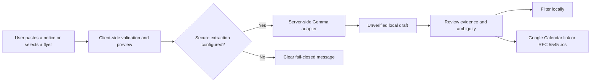

# CampusSync — reviewable campus notices, ready for a calendar

> **Hacktoberfest Hack Day Ikeja × Build54 & LASUCOM (MLH) project**
> **Status:** deployed AI extraction and sign-in are configured through managed environment variables; the local workflow also fails closed when provider configuration is absent.

CampusSync helps a student turn a **user-supplied** campus flyer or broadcast into a reviewable, calendar-ready action. It is built for the unglamorous but consequential moment when an exam date, departmental deadline, or society event is buried in a chat or pictured in a flyer.

The project’s central rule is the **Mirror Principle**: CampusSync must not create news. An action keeps its source excerpt, uncertainty, and local verification state. “Verified” means the user reviewed it locally; it never means LASUCOM or any other institution has endorsed or verified it.

## Why this exists

Students should not have to be manual calendar clerks just because information is fragmented across broadcasts, flyers, and notice boards. Yet a generic AI summary is not a safe substitute for an academic notice: one incorrect time or date can be costly.

CampusSync treats AI as a structured-draft assistant, then keeps the human in the loop:



This is intentionally narrower than a campus news platform. CampusSync does not scrape WhatsApp, assert an official partnership, or silently turn model output into institutional fact.

## What is in the repository

- A Vite/JavaScript browser application with a LASUCOM-focused dashboard, notice feed, exam tracker, and searchable organization directory.
- Text-notice capture with a 2,000-character client-side limit and image preview for PNG, JPEG, and WEBP flyers up to 5 MB.
- Local draft persistence and explicit review language for AI-created drafts.
- Calendar utilities that generate RFC 5545 `.ics` files and Google Calendar links in `Africa/Lagos` time.
- A six-category directory with 60+ entries; contact fields deliberately say **“Contact information to be confirmed”** rather than inventing details.
- A serverless extraction endpoint that calls DigitalOcean-hosted Gemma 4 through server-only Vercel environment variables, with an OpenRouter Gemma fallback. It returns a clear error instead of claiming an upload was analysed when neither provider is available.
- Supabase-backed Google OAuth and email magic-link sign-in, plus a schema for organization-scoped roles and Row Level Security (RLS).
- Student profile setup for department, level, and campus context, with database-backed default subscriptions to LASUCOM Administration, the Academic Office, and Student Affairs.
- An authenticated “My subscriptions” workspace for optional communities, including NiMSA, IFMSA standing committees, Red Cross, CMDA, MSSN, JCCF, PANS, and LASUMSA.
- MIT licensing and automated tests for text limits, calendar behavior, the fail-closed path, time-zone handling, and directory integrity.

## Trust and data boundaries

| Boundary | What CampusSync does | What it does not do |
| --- | --- | --- |
| Source | Accepts a user-supplied paste or selected image | Scrape WhatsApp, group chats, or institutional systems |
| Extraction | Produces an unverified draft when server-side AI is configured | Present a draft as an official notice |
| Verification | Lets a user record local confirmation | Claim LASUCOM or an organization verified anything |
| Storage | Keeps structured local drafts in the browser | Store raw notice content or file previews on a CampusSync server |
| Samples | Uses visibly labelled fictional/sample content | Pass a sample off as a real campus notice |
| Credentials | Uses server-side deployment secrets for AI providers | Ship keys, endpoints, or models to the browser or Git |

## Run locally

Prerequisite: Node.js 20+ is recommended.

```bash
git clone https://github.com/hassanismailtech/campusync.git
cd campusync
npm install
npm run dev
```

Open the local URL printed by Vite.

Run the safeguards:

```bash
npm test
npm run build
```

## Optional: configure extraction safely

The deployed service keeps its AI credentials in Vercel environment variables. A local clone remains useful without an AI key: it previews uploads and preserves the fail-closed boundary. To enable the server route in another trusted deployment, configure server-only secrets such as:

```bash
DIGITALOCEAN_MODEL_ACCESS_KEY=
OPENROUTER_API_KEY=
```

Never prefix AI keys with `VITE_`, put them in frontend code, or commit them. The endpoint tries its configured DigitalOcean Gemma path first and only then its configured fallback. If neither succeeds, it returns a `503` and does not create a claimed AI result.

The architectural target is an authenticated, same-origin Gemma adapter with `GEMMA_ENDPOINT`, `GEMMA_API_KEY`, and `GEMMA_MODEL` stored as deployment secrets. See [docs/ARCHITECTURE.md](docs/ARCHITECTURE.md) and [docs/AI_AND_AUTH_SETUP.md](docs/AI_AND_AUTH_SETUP.md) before enabling a provider.

## Calendar correctness

Calendar output is not an afterthought. `src/domain.js` emits floating local date-times with `X-WR-TIMEZONE:Africa/Lagos`, rather than adding a UTC suffix that would shift a local exam time. Deadline-only items export as all-day events, and superseded items are omitted.

The generated description retains useful context:

- whether the item is unverified or locally confirmed;
- the stated source/organization; and
- the evidence excerpt used for review.

## Architecture

```text
Browser (Vite)
  ├─ local notice/directory data and filters
  ├─ browser-local drafts
  ├─ file preview and input validation
  └─ .ics / Google Calendar export
         │
         └─ POST /api/extract (only when configured)
                └─ server-side provider credentials → Gemma-capable endpoint
```

Raw notice text and previews are intended to remain transient. Provider access belongs behind the server boundary. Authentication is available, while institution-approved publisher workflows remain a future governance step.

## Identity and subscriptions

Students can explore the public dashboard without an account. Signing in with Google or an email magic link unlocks a personal profile and the subscription workspace.

- **Default official feeds:** LASUCOM Administration, College Academic Office, and Student Affairs are subscribed when a student completes their profile.
- **Optional communities:** students can choose additional association, committee, club, NGO, and fellowship feeds.
- **Privacy:** a student may read and manage only their own subscriptions; organization representatives and administrators will receive scoped publishing permissions through `user_roles`.

Google OAuth and magic links must be enabled in the connected Supabase project's Authentication settings. See [AI and auth setup](docs/AI_AND_AUTH_SETUP.md) for the deployment configuration.

## Honest project status

| Ready now | Deliberately not claimed as ready |
| --- | --- |
| Local dashboard and directory | Institutional partnership or endorsement |
| Browser input validation and image preview | Official notice verification |
| Local filters and draft persistence | Institutional partnership or official endorsement |
| `.ics` and Google Calendar output | Server-side storage of notices |
| DigitalOcean Gemma primary route with OpenRouter fallback | Automated WhatsApp ingestion |
| Supabase OAuth/magic-link sign-in and RLS schema | Institution-approved publisher governance |
| Student profiles and default/optional subscriptions | Automated duplicate rejection without human review |

## Roadmap

1. **Verified publishing:** give approved organization representatives scoped drafting and editing rights, with moderation and revision history.
2. **Trust safeguards:** use AI similarity checks to flag likely duplicate notices for human review—never silently reject a valid update.
3. **Personal delivery:** add opt-in WhatsApp/SMS and email digests for urgent or subscribed notices, with explicit consent and unsubscribe controls.
4. **Public information pages:** build About, Contact, Privacy, and Terms before opening the service beyond a pilot community.
5. **Open-source adoption:** document self-hosting, seed data, moderation policy, and deployment choices so other institutions can adapt CampusSync without inheriting LASUCOM-specific assumptions.

See the product boundaries and delivery gates before treating this as a production service:

- [Product contract](docs/PRODUCT_CONTRACT.md)
- [Architecture](docs/ARCHITECTURE.md)
- [Delivery gates](docs/DELIVERY.md)

## Contributing

Issues and pull requests are welcome. Please preserve the Mirror Principle, keep samples visibly fictional, and never add a feature that fabricates source evidence, official verification, or an extraction result.

## License

[MIT](LICENSE) © 2026 Hassan Ismail.
